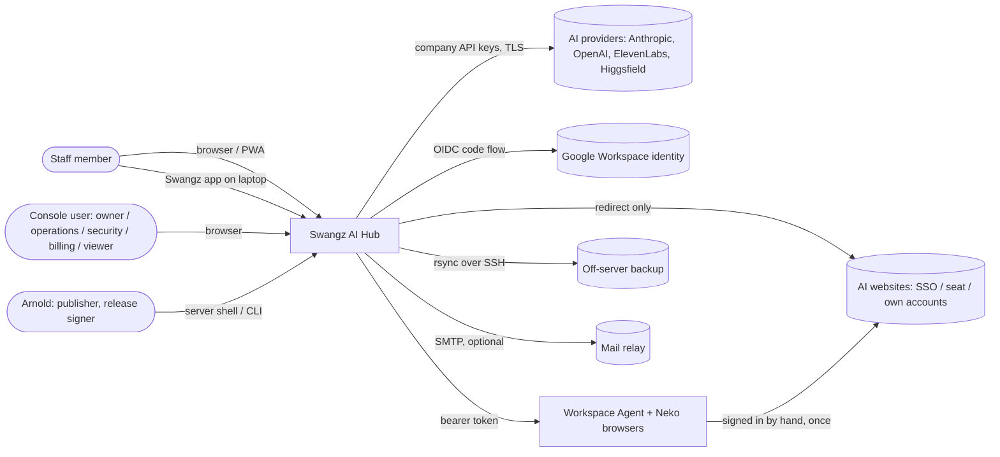
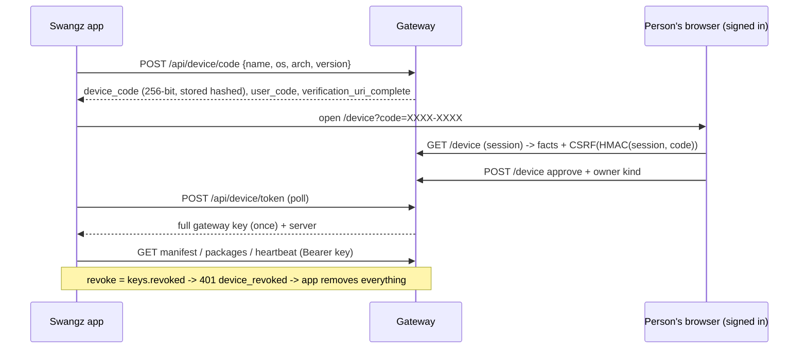

# Swangz AI Hub — architecture review (G1/G2)

Reviewed: 2 Nov 2026, `main` at `ba82a2a` (schema v21). Read-only assessment of the code as it is.
Companion documents: [SECURITY-REVIEW.md](SECURITY-REVIEW.md) (findings), [DECISIONS.md](DECISIONS.md)
(ADRs D-001…D-010), [PROVIDER-AUTH-BOUNDARIES.md](PROVIDER-AUTH-BOUNDARIES.md).

Test baseline: **Not run** by this review (team rule: reuse @Chief's recorded result). `docs/AGENT-PROGRESS.md`
did not exist on `main` when this was written, so no baseline was available to cite.

## 1. System context (C4 level 1)

## 2. Containers (C4 level 2)

| Container | Code | Runs where | Talks to | Credential it holds |
|---|---|---|---|---|
| Gateway (HTTP server + proxy + APIs) | `gateway/` (`server.py`, `proxy.py`) | Swangz server behind Caddy (or the laptop + tunnel) | SQLite, providers, Google, Workspace Agent, SMTP | provider keys (env), `internal_secret` (memory), Google client secret (env) |
| Database | `data/gateway.db`, `gateway/db.py` (v21) | same host | — | hashes of staff keys, sessions, passwords; request bodies; audit |
| Staff app / PWA | `gateway/static/index.html`, `portal.*` | staff browsers, phones | `/api` | `sgw_staff` cookie (HttpOnly, Lax, 14 days) |
| Control room | `gateway/static/admin*.js` | console browsers | `/admin/api` | `sgw_admin` cookie (HttpOnly, Strict, 12 h) + `x-gateway-admin` header |
| Swangz app | `swangz_client/` | Windows/macOS/Linux laptops | `/api/device/*`, the proxy | device key (a full gateway key) in `device.key` 0600 |
| Coding agents (Claude Code, Codex) | third-party, configured by `swangz_client/agents.py` | laptops | the proxy | the device key (env or settings file) |
| Browser access gate | `extension/` (MV3) | staff Chrome | `/api/gate/*`, `/api/extension/login` | a 30-day `staff_sessions` token in `chrome.storage.local` |
| Workspace Agent | `workspace_agent/agent.py`, `computer.py` | rented server, or Swangz PC/Mac | Docker, Neko, gateway `/api/workspace/hello` | agent token, per-container Neko API tokens |
| Backups | `gateway/backup.py`, `deploy/*backup*` | server timer | rsync target | SSH key in data folder |
| CI | `.github/workflows/checks.yml`, `build-app.yml` | GitHub Actions | — | none today (builds unsigned) |

## 3. Components and responsibilities (C4 level 3, gateway)

- **Edge / routing** `server.py`: static files, CSP (`CONSOLE_HEADERS`, `server.py:26`), `public_url()`
  (`server.py:212`, falls back to the Host header when `GATEWAY_PUBLIC_URL` is unset), key identification.
- **Proxy** `proxy.py` + `parse.py`: endpoint allowlist per dialect, strips client auth headers (`proxy.py:20`),
  adds the provider key, streams, records.
- **Gates** `server.gate` / `policy_gate` / `tool_policy`, `entitle.py`, `policy.py`, `reporting.gate`: the
  deterministic decision; fails closed.
- **Identity** `staff.py` (staff sessions, invites, extension login), `admin.py` (console sessions, route
  decorator with `area=`), `google.py` (OIDC), `config.email_allowed` (`config.py:127`: exact domain + two owner
  exceptions), `authz.py` (roles as areas).
- **Devices** `enroll.py`: device-code flow, manifest, heartbeat, packages, sign-out; `device_schema.py`.
- **Shared accounts** `turns.py`, `workspace.py`: one turn per person, company browsers via the agent.
- **Governance / money / trust / insight**: `govern.py`, `money.py`, `trust.py`, `insight.py`, `notify.py`.
- **Durability** `store.py` (retention), `backup.py`.

Desktop client components: `core.py` (Api, Store, Client), `agents.py` (Claude Code / Codex config),
`bundles.py` (verified unpack), `shell.py` (open URL, autostart), `cli.py`, `gui.py` (Tk).

## 4. Trust boundaries

| # | Boundary | Authenticated by | Weakest point today |
|---|---|---|---|
| TB1 | Internet → Caddy → gateway | TLS (Caddy, HSTS) | `GATEWAY_TRUST_PROXY`/Host header if mis-set |
| TB2 | Gateway → providers | provider keys in env | one key per provider pays for everyone |
| TB3 | Staff browser → `/api` | `sgw_staff` cookie **or the same token as Bearer** (`staff.py:66`) | extension token is a full staff session |
| TB4 | Console → `/admin/api` | `sgw_admin` cookie + header; area check | password-only sign-in, no second factor |
| TB5 | Device → `/api/device/*` and proxy | device key (Bearer) | key copied into tool settings / registry |
| TB6 | Gateway → device (manifest, packages, extension) | TLS + sha256 from the same server | **no signature independent of the gateway** |
| TB7 | Gateway ↔ Workspace Agent / computers | bearer tokens (`hmac.compare_digest`) | computer key may set the URL staff are sent to |
| TB8 | Neko browser ↔ vendor site | vendor session signed in by admin | browser policy (devtools off) is the only cookie barrier |
| TB9 | Server → off-server backup | SSH key | copies are plaintext |
| TB10 | CI → released binaries | GitHub | unpinned build tool, unsigned artefacts |

## 5. Key flows

### 5.1 Staff key → gateway → provider
Coding agent or SDK sends `x-api-key`/`Authorization` with `sgw_<id>_<secret>` → `security.client_token`
→ `gw.identify` (`server.py:131`: SHA-256 compare, email rule) → gates (entitlement, model registry, policies,
budgets, rate limit, kill switch, weekly report) → `proxy.py` drops client auth headers and adds the provider
key → streams back → record (+ body by hash). Revocation: `keys.revoked` + `live.cut`.

### 5.2 Staff and console sign-in
- Password: PBKDF2 (`security.py:61`), per-IP throttle (in memory), session token 256-bit, stored hashed.
- Google: state + nonce + state cookie, code exchanged server-to-server, `iss`/`aud`/`exp`/`nonce`/
  `email_verified` checked (`google.py:118`); **`hd` not checked**; no PKCE.
- Console: separate table and cookie; the staff session can never reach `/admin/api` (separate
  `current_admin`). Area enforced in `admin.dispatch` (`admin.py:81`).

### 5.3 Device enrolment and revocation

Controls present: 15-minute single-use codes, per-IP limits, CSRF bound to session and code, approval page
shows requester address, ten-device cap, audit of approve/refuse/enrol/sign-out. Gaps: see SECURITY-REVIEW
F-05, F-06, F-13.

### 5.4 Software distribution and updates (today)
- Packages: zip published by CLI on the server (`enroll.publish`), sha256 recorded, served only to granted
  people (`enroll.device_package`), app verifies sha256, safe-path unpack, staging then rename (`bundles.py`).
- Extension: zipped live from the server's `extension/` checkout (`enroll.extension_zip`), "Load unpacked".
- The app itself: built manually by `build-app.yml`, unsigned, no self-update; the manifest carries
  `client.latest/minimum` (`enroll.py:44`) and the app refuses to run below `minimum`.
- Root of trust for all three is **the gateway itself**. Target design: D-003/D-004.

### 5.5 Provider communication
Only the gateway holds provider keys; clients never see them; endpoint allowlist keeps staff to chat/coding/
media endpoints. Website tools are redirects (`/go/<tool>`); the Hub never holds vendor passwords; shared
accounts are reached only through company browsers signed in by hand. See PROVIDER-AUTH-BOUNDARIES.md.

## 6. Dependencies

Runtime: Python 3.10+ stdlib only (gateway, client, agent); Tk for the GUI; Docker + Neko on workspace hosts;
Caddy; systemd; rsync/ssh. Build/test only: PyInstaller (unpinned), pinned npm packages for browser checks.
New dependencies require Arnold's approval; the decisions below were chosen to need none at runtime.

## 7. Docs versus code

| Claim | Where | Reality |
|---|---|---|
| "a manifest can never send the key elsewhere" | CLIENT.md, SECURITY.md | true for downloads (`core.py:198`); **not** for the agent `base_url`, which is written with the key into tool config unchecked (`core.py:328`, `agents.py:106,141`) |
| "The key is never put in a file we did not already own" | `agents.py:11` | managed Claude Code writes the key into `~/.claude/settings.json` (`agents.py:106`); Windows Codex puts it in the user environment via `setx` (`agents.py:194`) |
| Device key "in a 0600 file … the user profile on Windows" | SECURITY.md Limits | on Windows it is `%APPDATA%` (Roaming, `core.py:54`): can replicate to a roaming-profile server |
| Extension "keeps a token" for the gate | `staff.py:465` | that token is a full 30-day staff session accepted on every `/api` route, including `/device` approval |
| SECURITY.md describes schema v20 | SECURITY.md | code is v21 (devices) — the device rows are present, header out of date |

## 8. Top 10 risks (likelihood × impact)

| Rank | Risk | L | I | Finding |
|---|---|---|---|---|
| 1 | Console taken over by password guessing/reuse (no second factor, per-IP throttle only) | M | Critical | F-01 |
| 2 | Device key leaks from `~/.claude/settings.json` / Windows user env (dotfile repos, backups, child processes) | H | High | F-02 |
| 3 | Gateway compromise ships code to every device (packages, extension, future updates) | L | Critical | F-03 |
| 4 | Stolen extension token approves an attacker's device → durable key | M | High | F-04 |
| 5 | Device-code phishing via prefilled link and attacker-chosen device name | M | High | F-05 |
| 6 | Consumer Google account on a work address bypasses Workspace offboarding/2SV | L–M | High | F-07 |
| 7 | Plaintext off-server backups of prompts/audit | L | High | F-08 |
| 8 | Unpinned build chain / unsigned app binaries | M | High | F-09 |
| 9 | Hostile manifest redirects the key or injects Codex config (TOML) | L | High | F-06 |
| 10 | Shared-account turns used on plans whose terms forbid sharing | M | Medium (legal/vendor suspension) | F-12 |

## 9. Recommended order of work

1. **G2 decisions** (this branch) → @Forge and @Prism start.
2. Credential storage (D-001, D-002) + stop copying the key (F-02) + origin pinning (F-06) — @Prism client,
   @Forge server columns/endpoints (migration v22, append-only).
3. Session hardening (F-01, F-04, F-07, F-10) — @Forge.
4. Device-code hardening (F-05, D-009) — @Forge.
5. Signed releases and packages (D-003, D-004) + CI pinning (F-09) — @Prism; key ceremony with Arnold.
6. Installers (D-005) — @Prism.
7. Desktop→web handoff (D-008) — @Forge + @Prism, only after 3 is done.
8. Backups encryption (F-08) — @Sentinel/deploy, needs Arnold (tooling).
9. @Probe: provider facts in PROVIDER-AUTH-BOUNDARIES.md, journey tests; then G8 review by @Sentinel.
